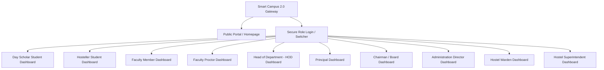

# 🎓 Smart Campus 2.0 — Autonomous Institutional Platform

[](https://reactjs.org/)
[](https://vitejs.dev/)
[](https://reactrouter.com/)
[](https://supabase.com/)
[](https://msg91.com/)
[](https://opensource.org/licenses/MIT)

**Smart Campus 2.0** is an enterprise-grade, autonomous institutional management and student lifecycle platform. Designed for modern colleges and universities, it integrates real GPS geofencing attendance, automated academic clearance workflows, multi-tiered gate passes, hostel administration, SMS parent alerts via MSG91, and 10 tailored role-based dashboard experiences into a single, cohesive, high-performance web application.

---

## 🌟 Key Highlights

- 📍 **Autonomous GPS Geofencing Attendance:** Real-time distance calculation verifying physical presence within campus boundaries (<100m geofence radius) with instant simulation controls for demo/testing.
- 📱 **100% Fully Responsive:** Tailored layouts for Mobile (swipeable capsule sub-navigation), Tablet (adaptive grids), and Desktop (sticky sidebar + flush header alignment).
- 🔐 **Frictionless Institutional Role Authentication:** One-click credential login across 8 major roles, with real-time persona simulation and quick jumping.
- 📑 **Official Printable Documents:** Automatic generation and instant printing for Academic Clearance Slips, Exit Gate Passes, and Authenticated Certificates.
- 📲 **SMS & OTP Notifications (MSG91):** Integrated SMS triggers for automated gate-pass approvals, attendance anomalies, and emergency parent broadcasts.
- 🏛️ **10 Dedicated Persona Experiences:** Tailored UI workflows for Day Scholars, Hostellers, Faculty, Proctors, HODs, Principals, Chairmen, Admin Directors, Wardens, and Superintendents.

---

## 🏗️ System Architecture & 10 Role Dashboards



### Role Matrix & Features Overview

| Role | Target User | Key Capabilities |
| :--- | :--- | :--- |
| **Day Scholar Student** | Commuter Students | GPS Geofence Attendance, Clearance Tracking, Gate Pass, Fee Receipts, Slips |
| **Hosteller Student** | Resident Students | Hostel In-Out Pass, Night Curfew Log, Mess Menu Feedback, Room Complaints |
| **Faculty Member** | Teaching Staff | Class Attendance Verification, Routine, Subject Clearance Approvals, Leave Requests |
| **Proctor** | Student Counselors | Batch Attendance Review, Gate Pass Authorization, Parent SMS Alerts |
| **Head of Dept (HOD)** | Department Heads | Faculty Workload, Department Notices, Subject Clearance Verification |
| **Principal** | Academic Head | College-wide Analytics, Institutional Approvals, Circulars & Governance |
| **Chairman** | Governing Board | Executive KPIs, Placement Metrics, Capital Planning, Financial Analytics |
| **Admin Director** | Operations Head | Facilities Maintenance, Vendor Contracts, AICTE/BPUT Regulatory Compliance |
| **Hostel Warden** | Hostel In-Charge | Night Roll Call, Gate Entry Tracking, Room Maintenance & Allotments |
| **Hostel Superintendent**| Chief Hostel Admin | Mess Quality Audits, Hostel Discipline, Security Protocols, Policy Oversight |

---

## 🚀 Getting Started

### Prerequisites

Ensure you have the following installed on your workstation:
- **Node.js:** v18.0.0 or higher
- **npm:** v9.0.0 or higher

### Installation

1. **Clone or navigate to the repository:**
   ```bash
   cd campus-2.o
   ```

2. **Install project dependencies:**
   ```bash
   npm install
   ```

3. **Configure Environment Variables:**
   Create or verify your `.env` file in the root directory:
   ```env
   # Supabase Configuration
   VITE_SUPABASE_URL=https://your-supabase-id.supabase.co
   VITE_SUPABASE_ANON_KEY=your_supabase_anon_key

   # MSG91 SMS & OTP Gateway Configuration
   VITE_MSG91_AUTH_KEY=your_msg91_auth_key
   VITE_MSG91_SENDER_ID=SMTCMP
   VITE_MSG91_TEMPLATE_ID=your_template_id
   VITE_MSG91_OTP_TEMPLATE_ID=your_otp_template_id
   ```

4. **Launch the local development server:**
   ```bash
   npm run dev
   ```
   Open your browser and navigate to `http://localhost:5173`.

---

## 🔑 Demo Login Credentials (Quick Simulator)

You can select any role from `/login` or use the quick persona shortcuts at the bottom of the login card:

| Role | Identifier / Email | Default Password | Initial Route |
| :--- | :--- | :--- | :--- |
| **Day Scholar** | `student@smartcampus.edu.in` | `demo1234` | `/dashboard/day_scholar` |
| **Hosteller** | `student@smartcampus.edu.in` (Hosteller tab) | `demo1234` | `/dashboard/hosteller` |
| **Faculty** | `faculty@smartcampus.edu.in` | `demo1234` | `/dashboard/faculty` |
| **Proctor** | `faculty@smartcampus.edu.in` (Proctor tab) | `demo1234` | `/dashboard/proctor` |
| **HOD (CSE)** | `hod@smartcampus.edu.in` | `demo1234` | `/dashboard/hod` |
| **Principal** | `principal@smartcampus.edu.in` | `demo1234` | `/dashboard/principal` |
| **Chairman** | `chairman@smartcampus.edu.in` | `demo1234` | `/dashboard/chairman` |
| **Admin Director** | `administration_director@smartcampus.edu.in` | `demo1234` | `/dashboard/administration_director` |
| **Hostel Warden** | `warden@smartcampus.edu.in` | `demo1234` | `/dashboard/warden` |
| **Hostel Superintendent** | `superintendent@smartcampus.edu.in` | `demo1234` | `/dashboard/superintendent` |

---

## 📁 Project Directory Structure

```text
campus-2.o/
├── index.html                   # HTML Entry Point
├── package.json                 # Scripts & NPM Dependencies
├── vite.config.js               # Vite Build Configuration
├── src/
│   ├── main.jsx                 # React Application Bootstrap
│   ├── App.jsx                  # Main Router & Global Providers
│   ├── components/              # Shared & Reusable Components
│   │   ├── Navbar.jsx           # Public Navigation Header (Mobile Drawer)
│   │   ├── NotificationBell.jsx # Live Notification Capsule
│   │   ├── PrintableSlipModal.jsx # Official PDF/Print Layout Generator
│   │   ├── RegistrationModal.jsx# OTP & Role Registration Workflow
│   │   ├── AIChatAssistant.jsx  # Smart Campus Virtual Concierge
│   │   └── dashboards/          # 10 Role Dashboard Components
│   │       ├── DayScholarDashboard.jsx
│   │       ├── HostellerDashboard.jsx
│   │       ├── FacultyDashboard.jsx
│   │       ├── ProctorDashboard.jsx
│   │       ├── HodDashboard.jsx
│   │       ├── PrincipalDashboard.jsx
│   │       ├── ChairmanDashboard.jsx
│   │       ├── AdminDirectorDashboard.jsx
│   │       ├── WardenDashboard.jsx
│   │       └── SuperintendentDashboard.jsx
│   ├── contexts/                # React Contexts (Auth, Campus Data)
│   │   ├── AuthContext.jsx      # Authentication & Role State
│   │   └── CampusContext.jsx    # Live In-Memory Attendance & Gate Passes
│   ├── data/                    # College Mock Data & Institutional Config
│   │   └── collegeData.js
│   ├── pages/                   # Application Page Views
│   │   ├── Home.jsx             # Public Landing Page
│   │   ├── LoginPage.jsx        # 8-Role Credential Login View
│   │   ├── RegisterPage.jsx     # Institutional User Registration
│   │   └── DashboardHub.jsx     # Master Dashboard Shell (Fixed Topbar)
│   ├── services/                # Backend API & Infrastructure Connectors
│   │   ├── authService.js
│   │   ├── mapService.js        # GPS Coordinates & Haversine Distance
│   │   ├── msg91Service.js      # MSG91 SMS & OTP Dispatch Service
│   │   ├── notificationService.js
│   │   └── supabaseClient.js    # Supabase Client Instance
│   └── styles/                  # CSS Design Systems
│       ├── index.css            # Base Styles & Color Variables
│       └── campus.css           # Layouts, Topbar, Sidebar & Responsive Queries
```

---

## 🛠️ Scripts Reference

| Command | Description |
| :--- | :--- |
| `npm run dev` | Starts Vite local development server on `http://localhost:5173` |
| `npm run build` | Compiles optimized production bundle into `/dist` |
| `npm run preview` | Runs local web server to preview production build |

---

## 🔒 Security & Invariants

1. **GPS Geofence Enforcement:** Attendance verification calculates Haversine distance from the institute central coordinate `(20.40798, 85.86774)`. Submissions outside 100 meters are automatically flagged for Proctor review.
2. **Deterministic Role Isolation:** Dashboard views enforce strict role checking through `AuthContext`.
3. **Session Persistence:** State persists across reloads via `localStorage` with instantaneous session revocation on `Sign Out`.

---

## 📄 License

This project is licensed under the **MIT License** — see the [LICENSE](LICENSE) file for details.
